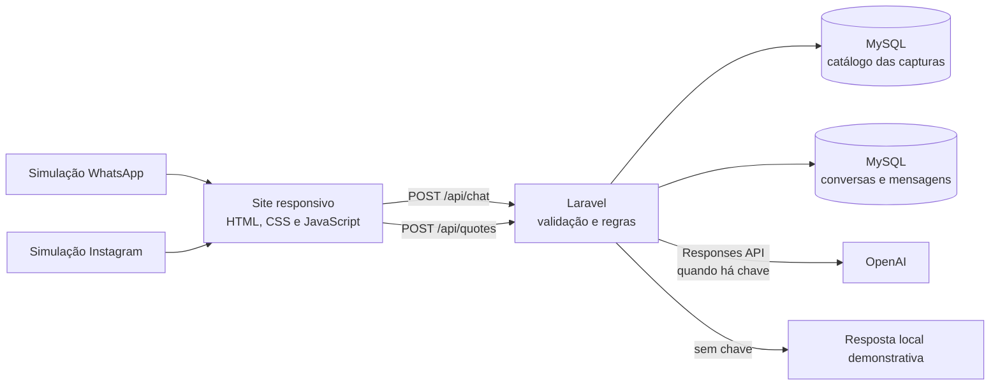

# Manu IA — roteiro de apresentação

## Resumo do projeto

Manu IA é um protótipo de atendimento para a ManuPekena. A ideia é ajudar uma pessoa interessada em uma peça artesanal a conhecer o catálogo, tirar dúvidas e iniciar uma conversa que pode continuar em diferentes canais. A página usa fotos reais das peças enviadas pelo usuário; preços, disponibilidade e personalização precisam de confirmação. O protótipo não acessa contas reais nem envia mensagens.

## Sugestão de fala

> A ManuPekena vende peças artesanais de biscuit inspiradas na fauna da Mata Atlântica. Como parte dos clientes compra uma vez e não retorna, o projeto explora como um agente de atendimento pode apoiar a descoberta de produtos e o relacionamento após a compra. O protótipo tem as fotos reais das seis peças recebidas, um simulador de orçamento de referência, um chat e um painel administrativo. O Laravel valida mensagens, consulta o catálogo, calcula simulações e guarda o histórico compartilhado entre os canais simulados. No modo de demonstração, o chat responde sobre peças, valores, disponibilidade e perguntas de continuação; com a chave configurada, usa a Responses API da OpenAI. O painel permite acompanhar conversas, conferir a preferência de novidades, revisar o catálogo e atualizar orçamentos. Nenhuma conta social é conectada e nenhuma mensagem externa é enviada. Preço e disponibilidade precisam ser confirmados.

## Demonstração em 3 minutos

1. Mostre o aviso no topo: fotos são reais; valores e disponibilidade precisam de confirmação.
2. Apresente os cartões das seis peças e o preço de referência de R$ 39 que aparece nas capturas fornecidas.
3. Simule algumas unidades de uma peça. Explique que o Laravel usa o valor da captura e registra o orçamento como pendente; personalização e prazo precisam ser confirmados.
4. No chat, pergunte pelo tatu-galinha e depois pergunte “quanto custa?”. Mostre que a Manu entende que “custa” se refere à peça da pergunta anterior.
5. Troque entre Site, WhatsApp e Instagram. Mostre as diferenças de aparência e tom, o histórico compartilhado e a indicação de que mensagens não são enviadas.
6. Pergunte sobre prazo ou disponibilidade. O agente informa o que o cadastro recebido diz e deixa clara a necessidade de confirmação.
7. Mostre que a autorização para receber novidades começa desmarcada e que não há envio real de campanhas.
8. Explique a diferença entre os dois modos: sem chave configurada, as respostas são locais e limitadas; com a chave no `.env`, o Laravel chama a OpenAI pelo servidor.
9. Entre no painel em `/admin/login` com uma conta criada pelo comando `php artisan admin:create-user`. Mostre o filtro de consentimento, o histórico da conversa e um orçamento relacionado.

## Arquitetura atual

O navegador não recebe a chave da OpenAI. O Laravel envia a mensagem e um recorte do histórico junto com o catálogo atual. A instrução do agente proíbe inventar dados de produto e o pedido à API usa `store: false`. As conversas necessárias ao protótipo ficam no banco do próprio projeto.

## Termos explicados

- **Laravel:** estrutura PHP que recebe pedidos do site, valida dados e aplica regras do sistema.
- **Rota / endpoint:** endereço do servidor que executa uma ação. Por exemplo, `POST /api/chat` recebe uma mensagem.
- **Banco de dados:** local organizado para guardar produtos, conversas e mensagens; este ambiente usa MySQL.
- **Responses API:** interface da OpenAI usada pelo Laravel para gerar uma resposta textual.
- **Variável de ambiente:** configuração guardada fora do código versionado. A chave da API fica em `OPENAI_API_KEY` no arquivo `.env` local.
- **n8n:** ferramenta planejada para disparar fluxos automáticos, como acompanhamento de orçamento. Ainda não está conectada.

## Escopo e próximos passos

Este protótipo já demonstra a página com fotos das peças reais enviadas, o atendimento contextual no modo local, a integração preparada com a OpenAI, o histórico compartilhado entre canais simulados, a validação de entrada, a preferência de consentimento, o orçamento calculado no Laravel e o painel protegido para gestão do catálogo, conversas e situação dos orçamentos.

Ainda precisam ser desenvolvidos e verificados: perfis de clientes com consentimento explícito, registro de compras, pós-venda, recuperação de orçamentos, recomendações e fluxos n8n. Antes de usar dados reais, a empresa deve fornecer as informações corretas e revisar as regras de privacidade e retenção.
